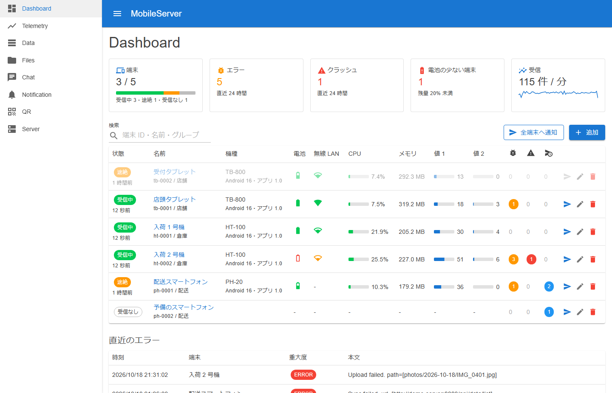
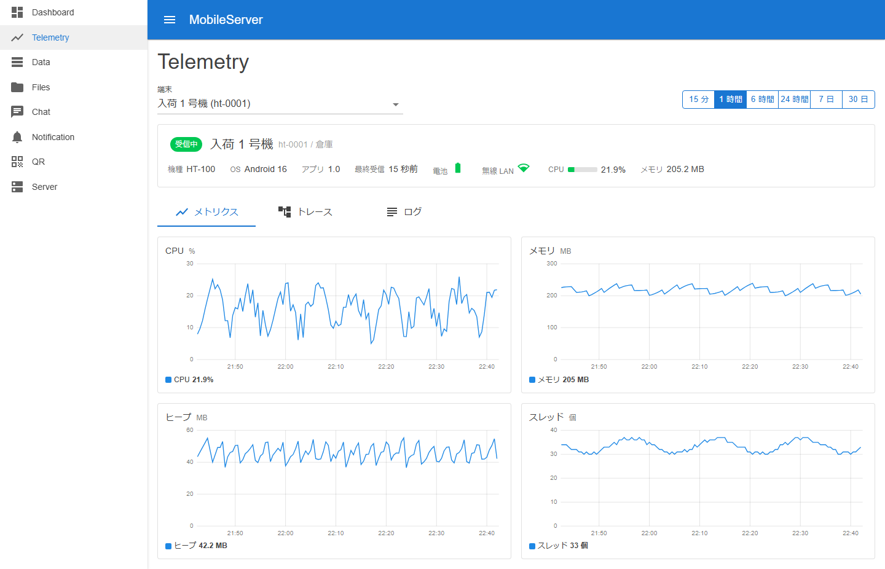
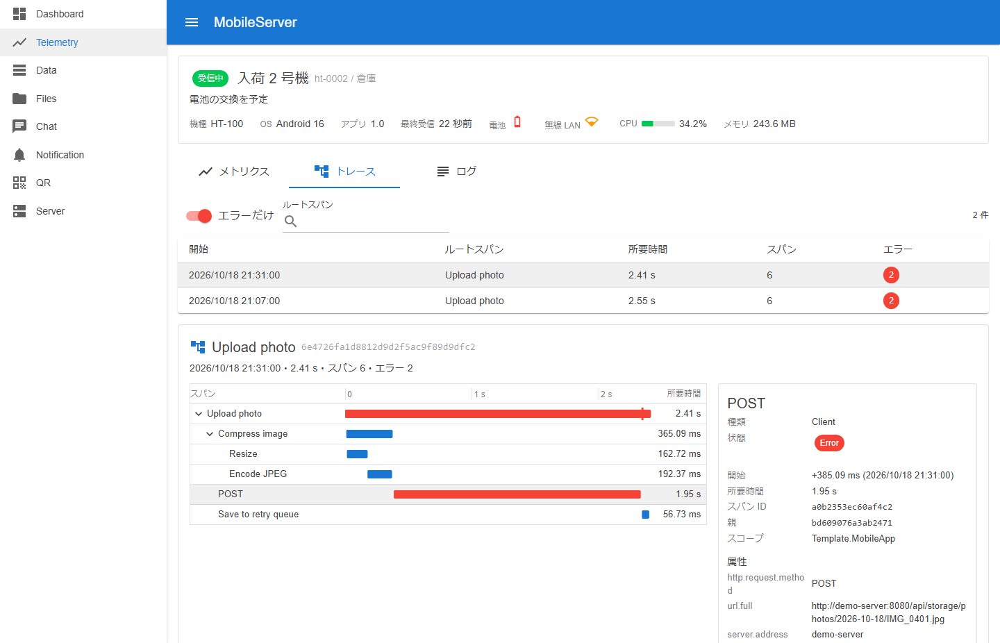
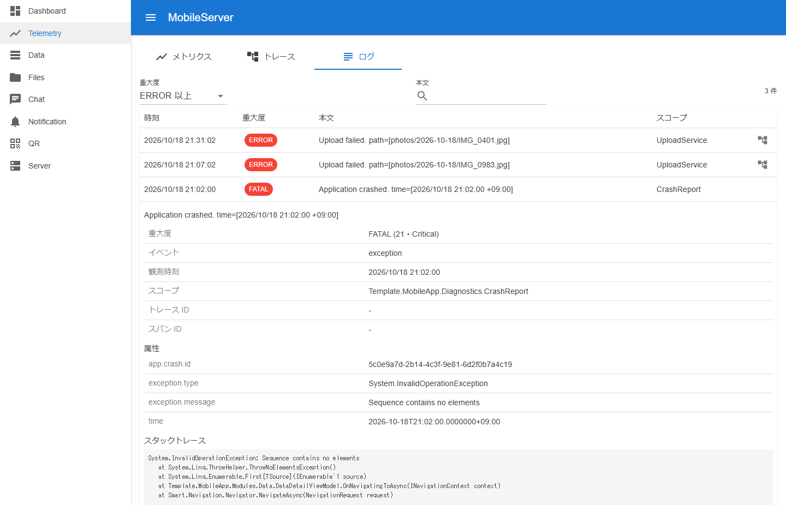
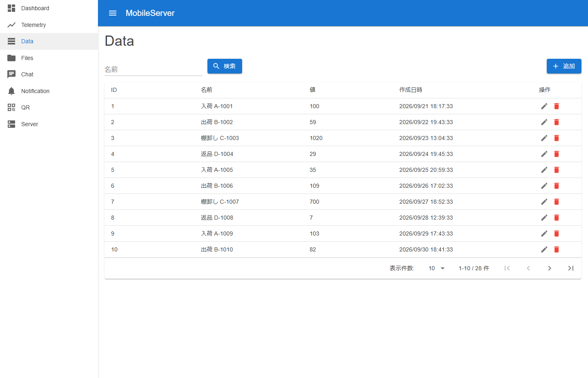
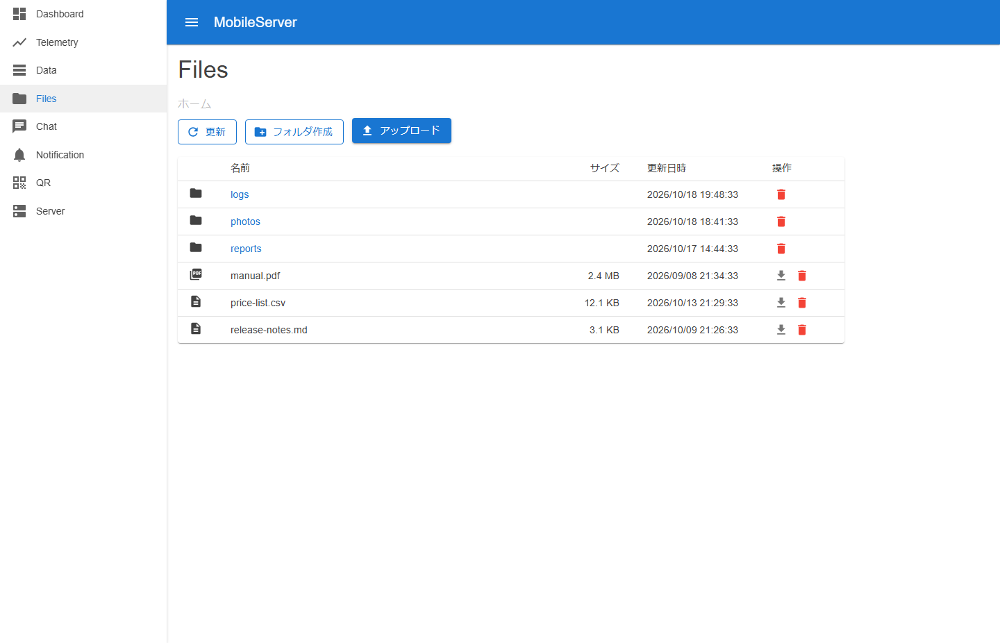
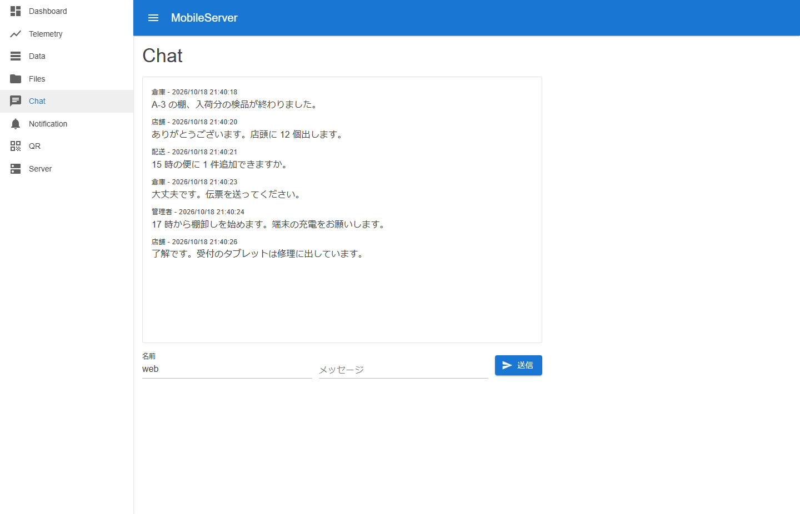
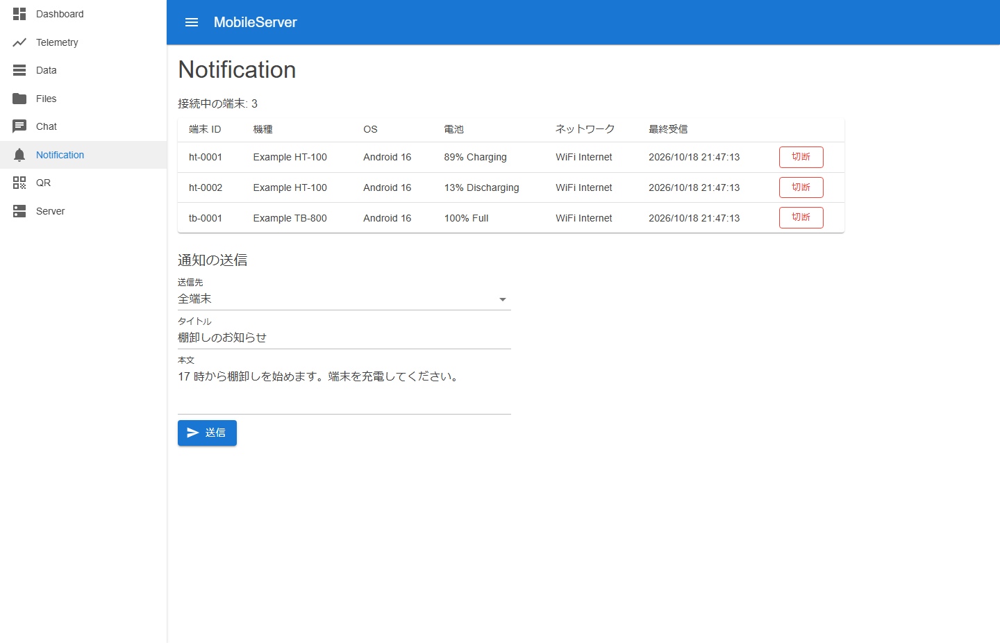
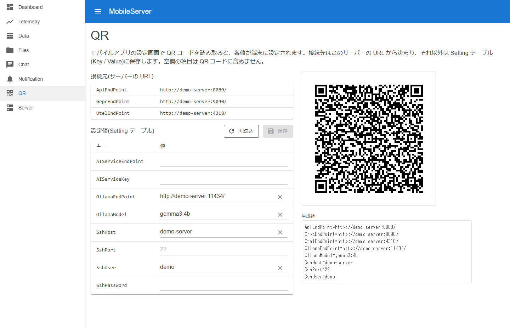
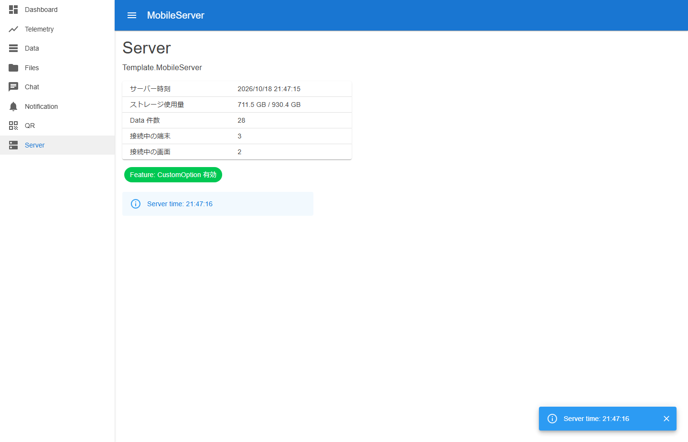

# Template project for Mobile Server

[English](README.md) | 日本語

template-maui 系(maui / maui-blazor)の通信処理の対向となるサーバーテンプレート。
template-blazor-server をベースに、モバイル契約 API と管理画面を提供する。

# 📸 画像

# ✅ 実装

| 分類 | 機能 |
| --- | --- |
| API | モバイル契約 API(Minimal API・camelCase JSON) / JWT(確認用の 1 本) / ファイル保管 API / OpenAPI(Swagger UI・ReDoc) |
| リアルタイム | チャット(gRPC 双方向ストリーミング) / サーバー情報(gRPC 単項) / 端末監視(SignalR) / 端末への通知(SignalR・未達の保管) |
| テレメトリ | OTLP 受信(トレース・メトリクス・ログ。HTTP/protobuf と gRPC) / 端末ごとの SQLite 保存 / 端末登録 / 保持期間 |
| 管理画面 | ダッシュボード / テレメトリ(メトリクス・トレース・ログ) / データ / ファイル / チャット / 通知 / QR 設定 / サーバー(Blazor Server・MudBlazor) |
| 運用 | Serilog / OpenTelemetry / ヘルスチェック / 機能フラグ / Aspire AppHost |
| テスト | 単体(bUnit) / 結合(WebApplicationFactory) |

# 📚 ドキュメント

| ドキュメント | 内容 |
| --- | --- |
| [structure.md](docs/structure.md) | Web プロジェクトの構成 |
| [api.md](docs/api.md) | API 一覧とモバイル契約の要点 |
| [admin.md](docs/admin.md) | 管理画面一覧 |
| [running.md](docs/running.md) | 起動とテスト |
| [communication.md](docs/communication.md) | チャット(gRPC)・端末の監視と通知(SignalR)・テレメトリの受信(OTLP) |
| [qr-settings.md](docs/qr-settings.md) | QR 設定フォーマット |

# 🔗 関連プロジェクト

| プロジェクト | 説明 |
| --- | --- |
| [template-maui](https://github.com/usausa/template-maui) | MAUI アプリのテンプレート |
| [template-maui-blazor](https://github.com/usausa/template-maui-blazor) | Blazor ベースのアプリのテンプレート |
| [template-maui-keyboard](https://github.com/usausa/template-maui-keyboard) | 物理キー操作の見本 |
| [template-maui-kiosk](https://github.com/usausa/template-maui-kiosk) | キオスク / MDM アプリの見本 |

# 📦 自作ライブラリ

| ライブラリ | 説明 |
| --- | --- |
| [Usa.Smart.Blazor](https://github.com/usausa/Smart-Net-Blazor) | Blazor ヘルパー |
| [Usa.Smart.Data.Accessor](https://github.com/usausa/Smart-Net-Data-Accessor) | データアクセス |
| [Usa.Smart.Mapper](https://github.com/usausa/Smart-Net-Mapper) | オブジェクトマッパー |
| [MiniDataProfiler](https://github.com/usausa/mini-data-profiler) | SQL プロファイラー |
| [BunnyTail.ServiceRegistration](https://github.com/usausa/bunnytail-service-registration) | サービス登録 |
