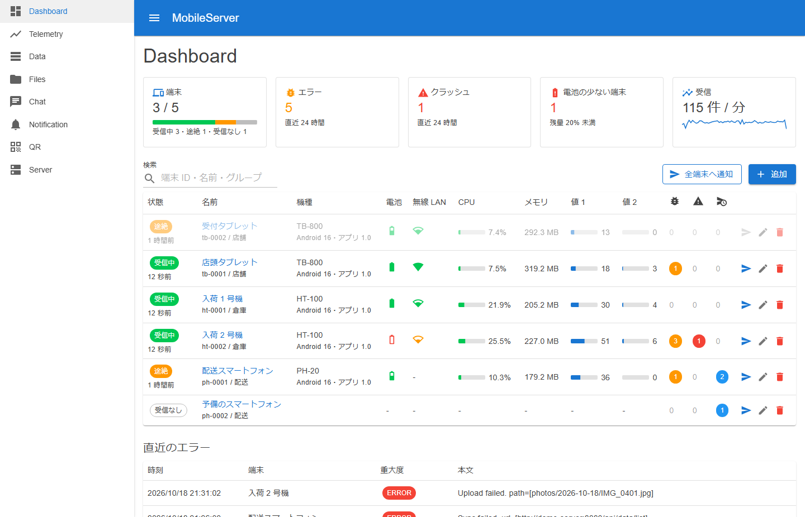
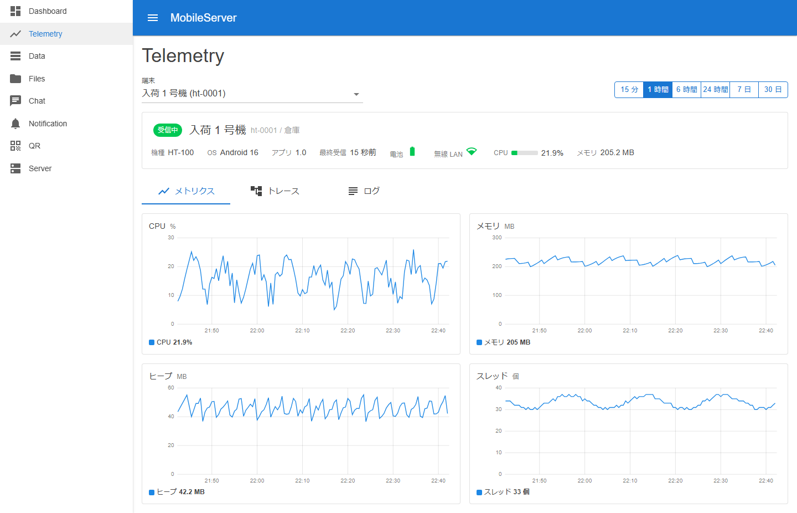
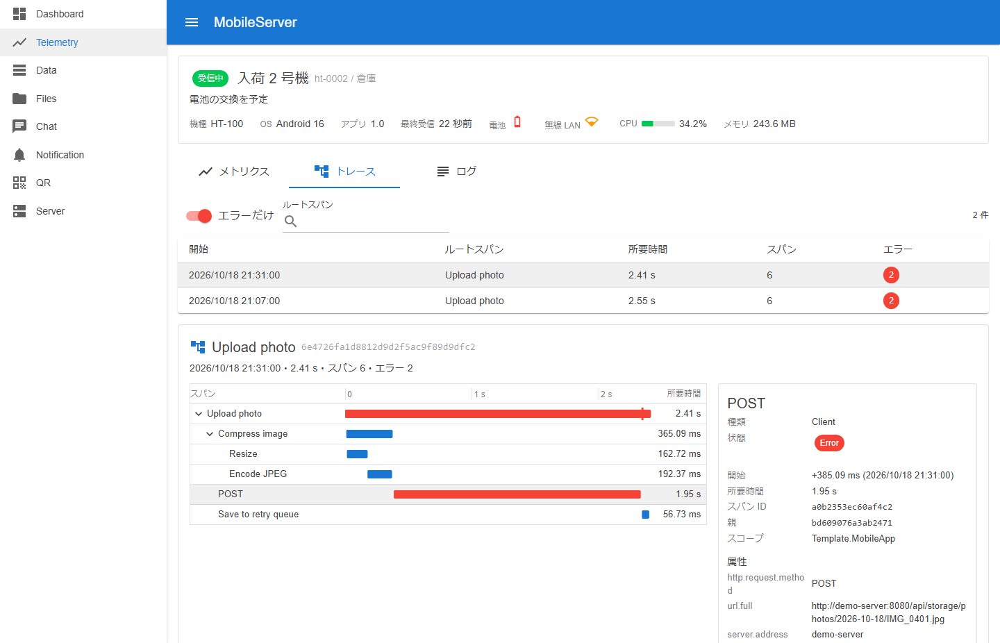
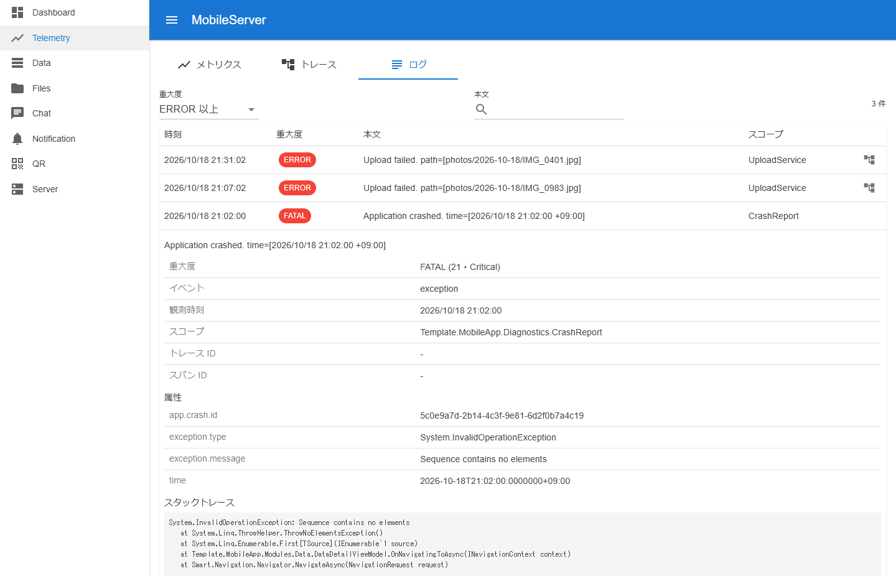
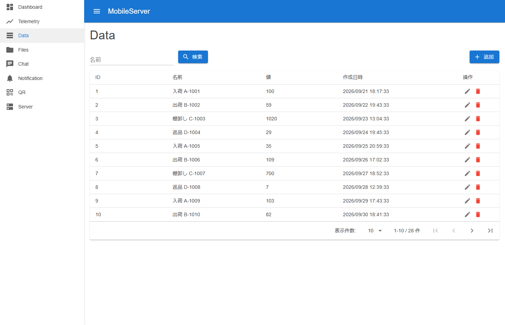
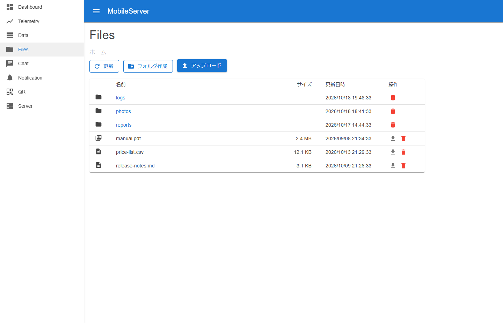
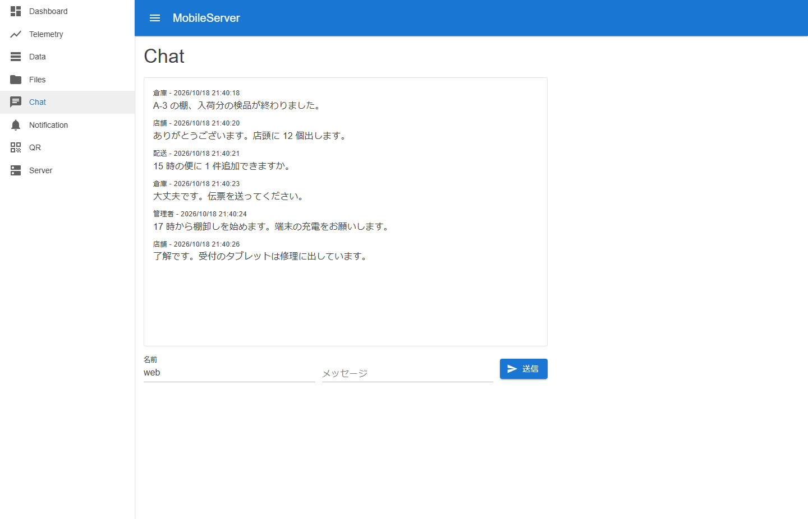
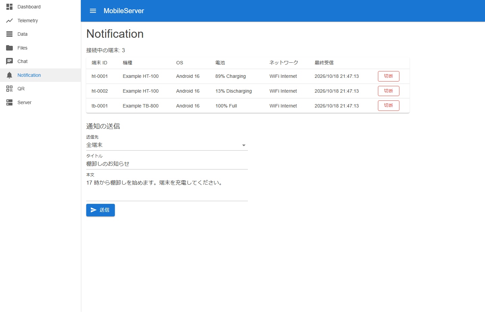
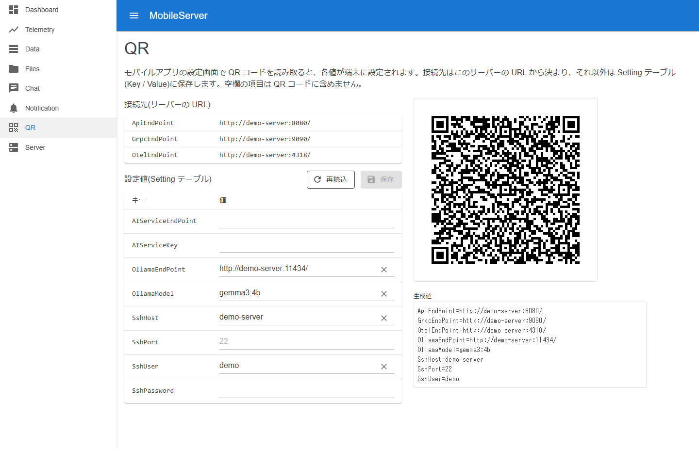
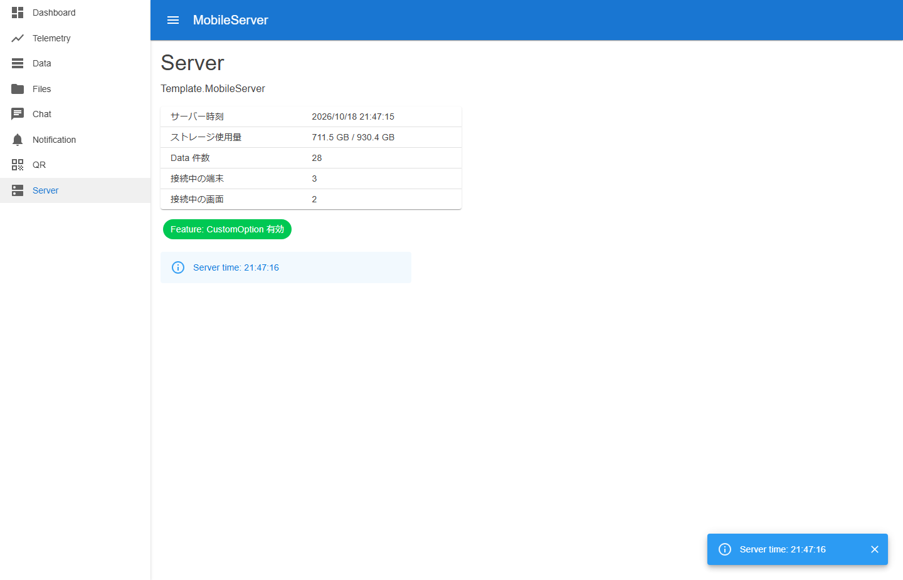

# Template project for Mobile Server

English | [日本語](README.ja.md)

[Template](https://usausa.github.io/template/) project for Mobile Server.

# 📸 Image

# ✅ Implement

| Category | Feature |
| --- | --- |
| API | Mobile contract API (Minimal API, camelCase JSON) / JWT (one API for the check) / File storage API / OpenAPI (Swagger UI, ReDoc) |
| Realtime | Chat (gRPC bidirectional streaming) / Server info (gRPC unary) / Device monitoring (SignalR) / Push to devices (SignalR, undelivered queue) |
| Telemetry | OTLP receiver (traces, metrics, logs over HTTP/protobuf and gRPC) / Per-device SQLite storage / Device registration / Retention |
| Admin | Dashboard / Telemetry (metrics, traces, logs) / Data / Files / Chat / Notification / QR settings / Server (Blazor Server, MudBlazor) |
| Operation | Serilog / OpenTelemetry / Health checks / Feature flags / Aspire AppHost |
| Test | Unit (bUnit) / Integration (WebApplicationFactory) |

# 📚 Docs

The documents in `docs` are in Japanese.

| Document | Contents |
| --- | --- |
| [structure.md](docs/structure.md) | Structure of the Web project |
| [api.md](docs/api.md) | API list and the mobile contract |
| [admin.md](docs/admin.md) | Admin pages |
| [running.md](docs/running.md) | Running and tests |
| [communication.md](docs/communication.md) | Chat (gRPC), device monitoring and push (SignalR), and telemetry (OTLP) |
| [qr-settings.md](docs/qr-settings.md) | QR settings format |

# 🔗 Related Projects

| Project | Description |
| --- | --- |
| [template-maui](https://github.com/usausa/template-maui) | MAUI application template |

# 📦 My Libraries

| Library | Description |
| --- | --- |
| [Usa.Smart.Blazor](https://github.com/usausa/Smart-Net-Blazor) | Blazor helpers |
| [Usa.Smart.Data.Accessor](https://github.com/usausa/Smart-Net-Data-Accessor) | Source generator based data accessor |
| [Usa.Smart.Mapper](https://github.com/usausa/Smart-Net-Mapper) | Object mapper |
| [MiniDataProfiler](https://github.com/usausa/mini-data-profiler) | SQL profiler |
| [BunnyTail.ServiceRegistration](https://github.com/usausa/bunnytail-service-registration) | Service registration generator |
